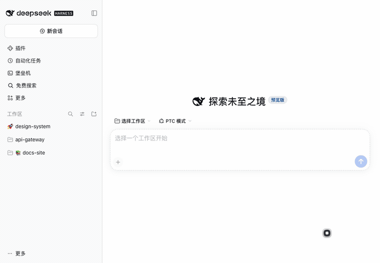

<div align="center">

# dsh-project-icon-plugin

**Give every workspace in the DSH sidebar its own icon: emoji, image, or text with a color.**

[](#install)

[](https://github.com/lifeopsgo/dsh-project-icon-plugin/releases)
[](./LICENSE)

[](./README.md) [](./README.en.md)



<sub>Recorded on demo data: three sample workspaces covering all three icon modes.</sub>

</div>

A **DeepSeek Harness (DSH)** WebUI plugin. It adds **Change project icon** to the workspace row menu so each workspace can use its own icon instead of the shared folder glyph. Icons live on the host in `$DSH_HOME/project-icons/icons.json`, so they survive a different browser or a cleared cache.

This plugin targets the DSH 0.2 line: `engines.dsh` is `>=0.2.2-rc.3 <0.3.0`. Uploaded images, including SVG, are rasterized in the browser to a 64 px WebP before they are stored. An SVG first passes size and structure checks (≤512 KB, no `foreignObject`, no embedded image data, bounded `use`/`image` counts) and is then decoded, so scripts inside a vector file are neither saved nor executed.

## Usage

1. Hover a workspace row in the sidebar and click the `...` button, or right-click the row.
2. Choose **Change project icon**.
3. Pick an icon with one of three modes: **emoji**, **image** (PNG, JPEG, WebP, or SVG; click to choose or drop a file), or **text** with a color.
4. **Replace folder icon** is on by default, so the icon replaces the folder glyph. Turn it off to keep the folder glyph and put the icon before the workspace name.
5. Use **Reset** to restore the shipped folder icon.

Rows with an icon keep it on hover, where it gently breathes instead of being swapped for the expand chevron.

## Install

```bash
dsh plugin --profile web add github:lifeopsgo/dsh-project-icon-plugin#v0.1.0
dsh --profile web web
```

Refresh the page after installing. Uninstall:

```bash
dsh plugin --profile web remove @local/dsh-project-icon
```

Development and release steps live in [CONTRIBUTING.md](./CONTRIBUTING.md).

## License

MIT
