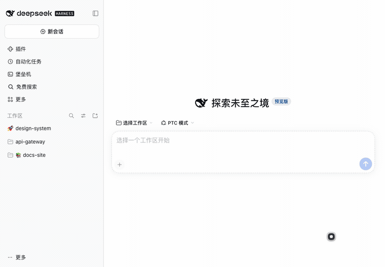

<div align="center">

# dsh-project-icon-plugin

**给侧边栏的每个工作区一个自己的图标：表情、图片，或文字加颜色。**

[](#安装)

[](https://github.com/lifeopsgo/dsh-project-icon-plugin/releases)
[](./LICENSE)

[](./README.md) [](./README.en.md)



<sub>演示数据：三个示例工作区，展示三种图标与悬停效果。</sub>

</div>

一个 DeepSeek Harness（DSH）WebUI 插件：工作区行右键菜单里多一项「修改项目图标」，给每个工作区单独设置图标，不再是千篇一律的文件夹。图标存在 Host 侧的 `$DSH_HOME/project-icons/icons.json`，换浏览器、清缓存都还在。

插件面向 DSH 0.2 线，`engines.dsh` 声明为 `>=0.2.2-rc.3 <0.3.0`。上传的图片与从图标库选中的图标都会在浏览器里栅格化成 64px 的 WebP 再存盘。SVG 先过体积与结构检查（≤512 KB、不含 `foreignObject`、不内嵌图片数据、`use`/`image` 元素数量受限），再解码；矢量里的脚本不会被保存或执行。

## 用法

1. 鼠标移到侧边栏的工作区行，点右侧 `...`，或直接右键该行。
2. 选「修改项目图标」。
3. 用四种方式之一挑图标：
   - **表情**：295 个图标按「常用 / 表情 / 自然 / 食物 / 活动 / 开发 / 其他」分组，常用组按使用频率排序；支持中英文关键词搜索，也可以直接粘贴任意表情；
   - **图标库**：匿名搜索 [iconfont.cn](https://www.iconfont.cn/) 的公开图标，选中即用（无需登录，搜索经 Host 代理转发；图标版权归上传者）；
   - **图片**：PNG / JPEG / WebP / SVG，点击选择或拖进来；
   - **文字**：1 到 2 个字符，可配颜色。
4. 「覆盖原图标」默认打开，图标直接替换文件夹；关掉则保留文件夹图标，把自定义图标加到项目名称前。
5. 想还原，点「恢复默认」。

设了图标的行，鼠标移上去时图标会轻微呼吸放大，不再被展开箭头替换。

## 图标库说明

- 搜索依赖 iconfont.cn 的公开接口（未对外文档化），对方调整或限流时会提示「连不上 iconfont」，已有图标不受影响。
- 搜索词会由 Host 发往 iconfont.cn，不做本地留存。
- 搜到的图标先用浏览器以图片方式渲染缩略图，选中后才做结构检查与栅格化；不合规的图标不会出现在结果里。
- 图标版权归上传者，商用前请确认所属图标库的授权。

## 安装

```bash
dsh plugin --profile web add github:lifeopsgo/dsh-project-icon-plugin#v0.1.0
dsh --profile web web
```

装完刷新页面。卸载：

```bash
dsh plugin --profile web remove @local/dsh-project-icon
```

开发与发布流程见 [CONTRIBUTING.md](./CONTRIBUTING.md)。

## 许可

MIT
