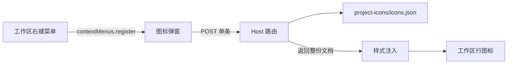

# 项目图标（Project Icons）

给 DeepSeek Harness 侧边栏的每个工作区设置独立图标：emoji、上传图片、文字加颜色三选一。图标数据保存在 Host 磁盘，换浏览器或清缓存都能恢复。

## 用法

1. 在侧边栏把鼠标移到工作区行，点右侧 `...`，或直接右键该行。
2. 选「修改项目图标」。
3. 在弹窗里切换「表情 / 图片 / 文字」三种方式，选好后保存。
   - 「覆盖原图标」默认打开：自定义图标替换掉官方文件夹图标。
   - 关掉后保留官方文件夹图标，把自定义图标追加到项目名称前。
4. 想还原官方文件夹图标，在弹窗左下角点「恢复默认」。

鼠标移到该行时图标不会消失，而是持续做轻微的放大缩小；行内「展开/折叠」箭头会让位给图标，点整行仍可展开。

## 数据存放

- 文件：`$DSH_HOME/project-icons/icons.json`（默认 `~/.dsh/project-icons/icons.json`），权限 `0600`。
- 结构：`{ "version": 1, "icons": { "<workspaceId>": <图标规格> } }`
- 图标规格：`{"kind":"emoji","value":"🚀"}`、`{"kind":"text","value":"AB","color":"#d1242f"}`、`{"kind":"image","value":"data:image/webp;base64,…"}`，外加 `placement`：`replace`（默认，替换官方图标）或 `prefix`（保留官方图标，追加到名称前）。

## 接口

| 方法 | 路径 | 说明 |
|---|---|---|
| GET | `/project-icon/icons` | 返回整份文档，供页面渲染 |
| POST | `/project-icon/icons` | 只写一条：`{"workspaceId":"…","icon":<规格>\|null}`，`null` 表示删除；返回更新后的整份文档 |

两个方法都先过 `ctx.connection.requestRejection`，未鉴权返回 401。错误码：`invalid-payload` 400、`payload-too-large` 413、`icon-limit` / `store-full` / `store-corrupt` 409、`read-failed` / `write-failed` 500。

## 工作原理



- 菜单项走官方扩展位 `ctx.contextMenus.register({ target: 'workspace' })`，`order` 取 200，夹在「重命名」100 与「删除工作区」300 之间。
- 弹窗用宿主 `@deepseek-ai/dsh-client-ui-primitives` 的 `Modal` / `Button`，焦点陷阱、Escape、层级由宿主负责。
- 图标落地靠 CSS 装饰层：`placement: replace` 时隐藏官方 `> span:first-child > svg`，在单元格 `::before` 上画 emoji、文字或图片；`placement: prefix` 时保留官方图标，在标题 `::before` 上画前置图标。官方目前没有「按工作区自定义图标」的扩展位，这一段依赖工作区行的 DOM 结构。
- 写入按工作区逐条进行，服务端串行化并做原子写（临时文件 + fsync + rename），多标签或两台浏览器同时改不同工作区不会互相覆盖。

## 已知限制

- 工作区行结构变化（`data-row-key` 改名，或文件夹单元格不再是第一个 `span`）会让图标样式失配；此时行内回到官方图标，菜单项与弹窗不受影响。
- 单张图片压缩后上限 48 KiB（64×64 WebP），工作区条目上限 200 个，整份文档上限 2 MiB；触顶返回明确错误码，不会静默丢弃。
- 图标文件损坏（JSON 不可解析或版本不符）时拒绝写入并返回 `store-corrupt`，避免把已有图标覆盖成空；需要人工修复或删除该文件。
- 两个标签页同时编辑**同一个**工作区时，以最后保存的一次为准。
- `placement: replace` 的行，悬停时不再显示展开箭头（位置让给图标），展开/折叠靠点击整行；未设图标或 `placement: prefix` 的行保持官方行为。
- 系统开启「减少动态效果」（`prefers-reduced-motion: reduce`）时不开呼吸动画。
- 只覆盖侧边栏工作区行，不影响首页的工作区选择器、搜索结果与 LiveShare 只读视图。

## 开发

```bash
node --test tests/*.test.mjs   # 单元测试（含产物新鲜度校验）
node scripts/build.mjs         # 重新生成 client.js
```

端到端脚本在 `.temp/e2e/`（不进版本库）：`./run.sh` 起一个独立 `DSH_HOME` 的实例，用 Playwright 驱动真实点击，覆盖菜单项与顺序、三种图标、写盘、第二个浏览器上下文恢复、恢复默认。

## 安装

在 Harness 会话里用 plugin manager 以目录方式安装本仓库：

```text
plugin_manager install_bundle /path/to/dsh-project-icon-plugin
```
